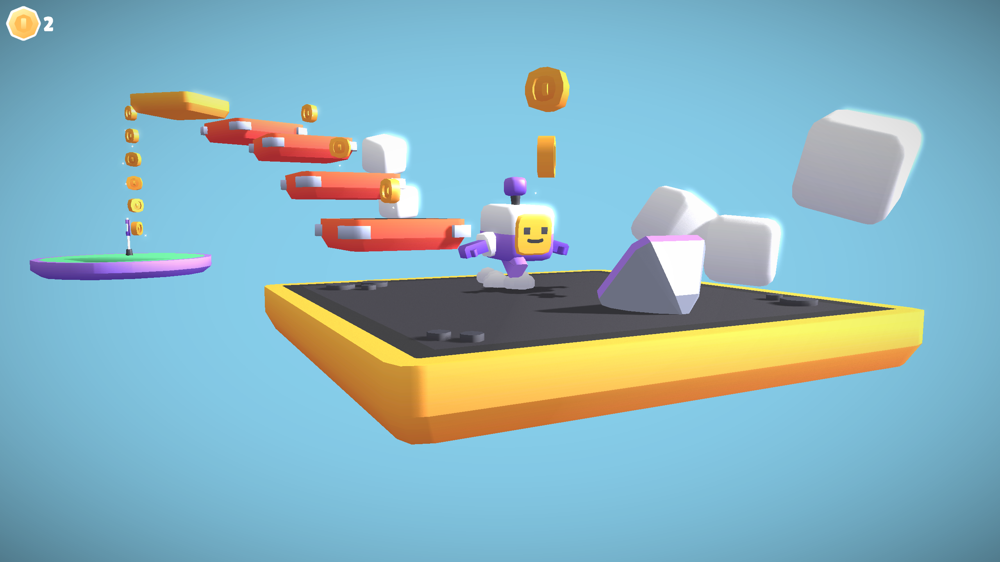

# The 3.8.6 Release 
 
We are pleased to announce the official release of MonoGame 3.8.6! 
 
This release brings updates across graphical backends, console and mobile support, the new content builder, the core framework, and more.

We also spoke about the release during out recent AMA. Watch [here](https://www.youtube.com/watch?v=gst0NFTgSPk)

Here are some highlights.
 
## Native OpenGL Backend 
 
3.8.6 introduces a new native OpenGL backend, DesktopGL4.  It targets OpenGL 4.1 and supports fallback to 3.1 at a minimum, so games can continue to work on lower-end systems while supporting more modern features in the future. 

This new native backend is also one of the steps towards the new [WebGL2 platform coming in 3.8.7](https://github.com/MonoGame/MonoGame/issues/9515). 
 

You can now play Platformer 3D starterkit over on our [itch.io account](https://monogame.itch.io/3d-platform-starter), which uses the new WebGL back end.
 
## Vulkan and DirectX 12 Improvements 
 
Vulkan receives render target synchronization and fixes for swapchain sizing.  DirectX 12 includes fixes to resource cleanup and two-sided stencil support. 

We expect to continue to make improvements to these foundational graphics backends that will eventually replace DirectX 11 and the original DesktopGL. 
 
## Platform Updates 
 
This release includes fixes and updates to our Xbox One & Xbox Series X|S support, as well as adding new support for [Nintendo Switch 2](https://docs.monogame.net/articles/console_access.html#nintendo-switch--switch-2).  Additionally, we added fixes for Android builds targeting .NET 10 and native mouse and touch input. 
 
## Framework Improvements 
 
The release includes general improvements and fixes across the framework, including: 
 
- Texture data APIs with `Span` overloads. 
- Vector rounding overloads and additional vector transform methods. 
- Fixes for SpriteFont spacing, video player state changes and disposed render target retention. 
- FBX model import orientation fixes. 
- Content Builder output cleanup and fixes for relative output directories. 
- Reduced installation size by stripping binaries. 
 
## StorageContainer is Back 
 
MonoGame has long lacked a way to store player save game data. The work was always left for the developer to create their own system, which often created problems porting titles to other platforms. 

To resolve this, we have revived the age-old StorageContainer XNA API, with a new modern implementation. You can now save and load player files through one consistent API that is designed to work across PC, mobile, and consoles. 

StorageContainer is still in preview for this release and is available on native platforms only, such as DesktopVK, WindowsDX12, and the new DesktopGL4 target.  We will continue to improve the solution in the coming months and make it available across more targets. 
 
## More Content Builder Improvements 

In our ongoing effort to modernize MonoGame’s content pipeline, we have continued the work on the new code-first content builder API.  Our goal is to replace the need for the old pipeline over the next few months. 

In 3.8.6, the Content Builder is now considered the recommended approach for building content. For this release we have: 
 
* Updated the Builder documentation. 
* Updated the automation samples. 
* Updated the existing Content Builder templates. 
* Progressed work on a new template that supports the Content Builder for all platforms. 

> *Note, if you have existing Content Builder projects from earlier releases, we recommend copying the latest template files from the nuget template by creating a new Content Builder project, or using the new documentation to refresh your project with the latest.  
 
## More Fixes and Polish 
 
We have also included a cleanup of the pipeline warnings with the content solution, additional macOS and Linux test coverage and fixes across graphics and content pipeline processing. Many of our Linux native binaries are now built using a Docker image for maximum compatibility. 
 
Thanks to everyone who contributed, including some of our first-time contributors: 
 
[@tyler-lutz](https://github.com/tyler-lutz) 
 
[@luvcraft](https://github.com/luvcraft) 
 
[@vondraysanford](https://github.com/vondraysanford) 
 
[@Ad4lb3rt](https://github.com/Ad4lb3rt) 
 
For the full changelog and release details, see the [3.8.6 release notes on GitHub](https://github.com/MonoGame/MonoGame/releases/tag/v3.8.6).
 

## What’s Next 

The team is excited to get moving on the 3.8.7 release.  It will mainly serve as hardening of the new target platforms and long due maintenance tasks that will help the project move forward.  At the same time, we are working on bigger tasks that appear in 3.9 including new font systems, a new unified shader compiler, native mobile platform support, a refreshed save game system and more. 

## Feedback

Any feedback or questions should be directed to the [MonoGame Discord Forum here](https://discord.com/channels/355231098122272778/1429828570993266778)

